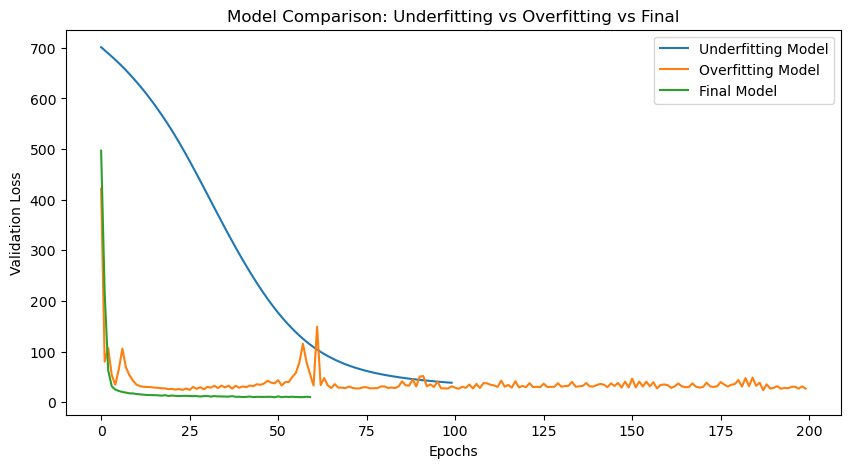
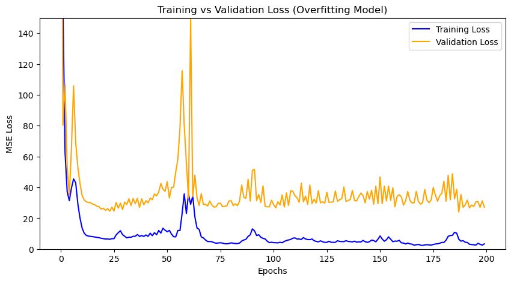
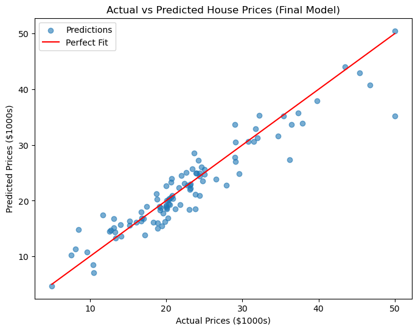

# House Price Prediction with Neural Networks

A deep learning regression project that predicts the **median home value of Boston suburbs** from 13 neighbourhood features such as crime rate, average number of rooms and pupil-teacher ratio. Three Keras networks are built and compared: one that underfits, one that overfits, and a final model tuned with dropout and early stopping. Built in Python with TensorFlow/Keras and scikit-learn.

[](https://colab.research.google.com/github/ziadelh/machine-learning-house-prices/blob/main/house_prices.ipynb)



| Model | MSE | MAE ($1000s) | R² |
|---|---|---|---|
| Underfitting (one hidden layer, 16 neurons) | 33.2 | 4.15 | 0.58 |
| Overfitting (five layers, up to 1024 neurons) | 12.4 | 2.09 | 0.84 |
| **Final** (128-64-32, dropout 0.1, early stopping) | **8.65** | **2.06** | **0.89** |

Evaluated on a held-out test set of 102 neighbourhoods. The random seeds are fixed, so the notebook gives the same numbers every time it is run.

<table>
  <tr>
    <td></td>
    <td></td>
  </tr>
</table>

## What it does

- **Preprocessing:** median imputation of missing values, train / validation / test split (64% / 16% / 20%) and feature standardisation fitted on the training data only
- **Underfitting model:** a deliberately tiny network, to show what too little capacity looks like
- **Overfitting model:** a deliberately huge network trained with a high learning rate, where the gap between training and validation loss shows up
- **Dropout search:** dropout rates from 0.1 to 0.5 compared on validation loss, with 0.1 the best
- **Final model:** three dense layers with dropout, trained with early stopping (it stopped after 60 epochs)
- **Evaluation:** MSE, MAE and R² for all three models, learning curves and actual-vs-predicted plots

## Dataset

[Housing price prediction](https://www.kaggle.com/datasets/shubhammeshram579/house) on Kaggle (CC0): the Boston housing data, 509 records, with `MEDV` (median home value in $1000s) as the target. A copy is included in `data/`.

## Run

```bash
pip install tensorflow pandas scikit-learn matplotlib jupyter
jupyter notebook house_prices.ipynb
```

Or use the **Open in Colab** button above, which loads the data from this repository.

## Tech Stack

Python · TensorFlow / Keras · scikit-learn · pandas · matplotlib

## Author

Ziad Elhussein
